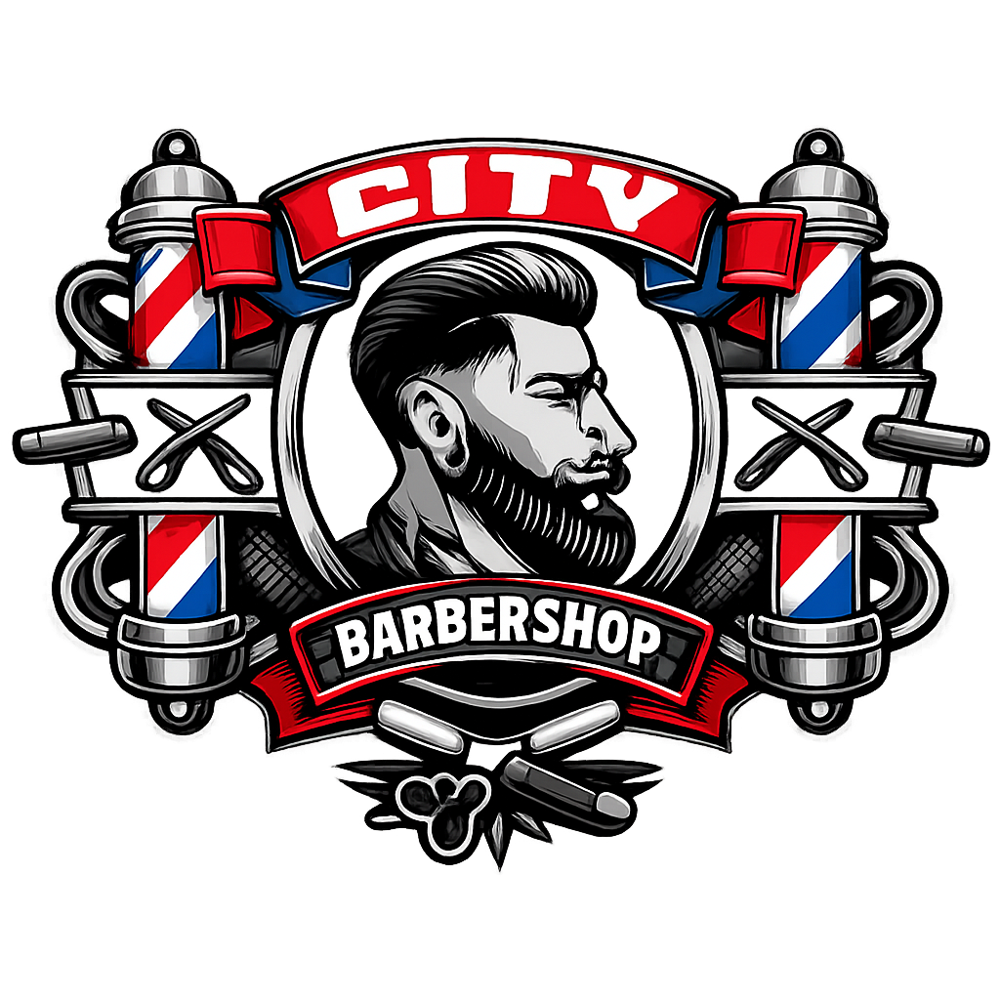

# City Barbershop - Drammen

En moderne, lynrask og responsiv nettside for City Barbershop i Drammen. Bygget med fokus på ytelse, SEO og brukervennlighet.



## 🚀 Funksjoner

*   **Premium Design:** "Dark-first" estetikk med gull/bronse aksenter for en eksklusiv følelse.
*   **Responsiv:** Fullt optimalisert for mobil, nettbrett og desktop.
*   **SEO-optimalisert:**
    *   Semantisk HTML5.
    *   Schema.org (LocalBusiness) integrasjon for bedre synlighet i Google Maps og søk.
    *   Dynamiske metatags med `react-helmet-async`.
*   **Ytelse:**
    *   Lynrask lasting med Vite.
    *   Lazy-loading av bilder.
    *   Minimal JavaScript-bundle.
*   **Interaktivt Kart:** Integrert Google Maps som viser lokasjonen i Tollbugata 14.
*   **Kontaktinfo:** Enkel tilgang til telefon, adresse og åpningstider.

## 🛠️ Teknologistack

*   **Frontend Framework:** [React 18+](https://react.dev/)
*   **Build Tool:** [Vite](https://vitejs.dev/)
*   **Styling:** [Tailwind CSS v3](https://tailwindcss.com/)
*   **Ikoner:** [Lucide React](https://lucide.dev/)
*   **SEO:** [React Helmet Async](https://github.com/staylor/react-helmet-async)

## 📂 Prosjektstruktur

```
src/
├── components/     # Gjenbrukbare UI-komponenter (Header, Hero, Services, etc.)
├── data/           # Statiske datafiler (services.js, team.js)
├── App.jsx         # Hovedkomponent som setter sammen siden
├── main.jsx        # Entry point
└── index.css       # Globale stiler og Tailwind imports
public/
└── logo.png        # Prosjektlogo
```

## 🚦 Kom i gang

Følg disse stegene for å kjøre prosjektet lokalt på din maskin.

### Forutsetninger

*   Node.js (v16 eller nyere)
*   npm (følger med Node.js)

### Installasjon

1.  Klon repositoriet:
    ```bash
    git clone https://github.com/Am11n/city-barbershop.git
    cd city-barbershop
    ```

2.  Installer avhengigheter:
    ```bash
    npm install
    ```

3.  Start utviklingsserveren:
    ```bash
    npm run dev
    ```

    Nettsiden vil nå være tilgjengelig på `http://localhost:5173`.

## 📦 Bygg for produksjon

For å lage en optimalisert produksjonsversjon:

```bash
npm run build
```

Dette genererer en `dist`-mappe som er klar for deployment.

## 🌍 Deployment

Prosjektet er klargjort for enkel deployment til tjenester som Vercel eller Netlify.

1.  Push koden til GitHub.
2.  Koble GitHub-repoet til Vercel/Netlify.
3.  Build-settings oppdages automatisk (Vite).
4.  Deploy! 🚀

## 📄 Lisens

Dette prosjektet er utviklet for City Barbershop Drammen.

## 📅 TeqBook-booking (prototype)

Bookingen bruker TeqBook sin offentlige bookingside (`/book/<slug>`), satt opp mot **staging**.

| Env-variabel | Standard | Beskrivelse |
| --- | --- | --- |
| `VITE_TEQBOOK_BASE_URL` | `https://staging.teqbook.com` | TeqBook-miljø |
| `VITE_TEQBOOK_SALON_SLUG` | `drammen-frisor` | Salongens slug i TeqBook (bytt til City Barbershop når salongen er opprettet) |
| `VITE_TEQBOOK_FORCE_EMBED` | – | `true` for å alltid prøve iframe |

TeqBook tillater bare at bookingsiden bygges inn (iframe) fra TeqBook-domener og `*.vercel.app`.
Deploy prototypen til Vercel for å vise bookingen innebygd. På `localhost` åpnes bookingen i ny fane.
Legg til `?embed=1` / `?embed=0` i URL-en for å overstyre.
